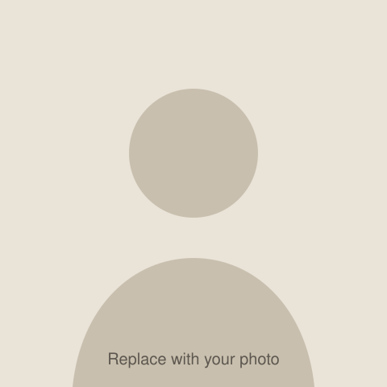

# Personal Website

A simple personal website made of plain HTML, CSS, and JavaScript.
There is nothing to install: no Node, no npm, no build step, no server.

```
index.html     ← all of your text lives here
styles.css     ← colours, fonts, and layout
script.js      ← small extras (mobile menu, dark-mode button, scroll animations)
images/        ← your photos and screenshots
README.md      ← this guide
```

---

## 1. Open the site on your computer

1. Open the project folder in Finder (Mac) or File Explorer (Windows).
2. Double-click **`index.html`**.
3. It opens in your web browser. That's the whole site.

Whenever you change a file, save it and refresh the browser tab
(**Cmd + R** on Mac, **Ctrl + R** on Windows) to see the change.

The site works offline and uses fonts that are already on your computer.

---

## 2. Push the project to GitHub

Your repository is **https://github.com/i-am-teegirl/tosin-portfolio**.
It's currently empty, which is what you want for the first push.

### One-time setup

1. Check that Git is installed. Open **Terminal** (Mac) or **Git Bash** (Windows) and run:

   ```bash
   git --version
   ```

   If you see a version number, you're set. If not, install Git from
   https://git-scm.com/downloads and reopen the terminal.

2. Tell Git who you are (use the same email as your GitHub account):

   ```bash
   git config --global user.name "Your Name"
   ```

   ```bash
   git config --global user.email "you@example.com"
   ```

### First push

1. In the terminal, move into the project folder. The easiest way is to
   type `cd ` (with a space), drag the project folder onto the terminal
   window, and press **Enter**.

2. Run these commands one at a time:

   ```bash
   git init
   ```

   ```bash
   git add .
   ```

   ```bash
   git commit -m "First version of my website"
   ```

   ```bash
   git branch -M main
   ```

   ```bash
   git remote add origin https://github.com/i-am-teegirl/tosin-portfolio.git
   ```

   ```bash
   git push -u origin main
   ```

3. When asked to sign in, follow the browser prompt, or use a
   **personal access token** as the password (GitHub no longer accepts your
   account password here). Create a token at
   GitHub → **Settings** → **Developer settings** → **Personal access tokens**.

4. Refresh your repository page on GitHub. Your files should be there.

### Every time after that

After editing files, save them and run:

```bash
git add .
```

```bash
git commit -m "Describe what you changed"
```

```bash
git push
```

---

## 3. Put it online with Netlify

You only do this once. After that, every `git push` updates the live site
automatically.

1. Go to https://app.netlify.com and sign up or log in (choosing
   **Sign up with GitHub** is easiest).
2. Click **Add new project** → **Import an existing project**.
3. Choose **GitHub** and allow Netlify to access your account if asked.
4. Pick the **tosin-portfolio** repository.
5. On the settings screen:
   - **Branch to deploy:** `main`
   - **Build command:** leave it **empty**
   - **Publish directory:** leave it **empty** (or type `.`). This means
     "the project root", where `index.html` lives.
6. Click **Deploy**. After a few seconds Netlify gives you a web address
   like `https://something-random.netlify.app`.
7. Optional: in **Project configuration** → **Change project name**, pick a
   nicer name, such as `tosin.netlify.app`.

From now on, each `git push` to `main` redeploys the site within a minute.

### After your first deploy: fix the sharing links

Open `index.html` and find every `https://your-site.netlify.app` near the
top (in the `<head>` section). Replace them with your real Netlify address.
This makes link previews on LinkedIn, iMessage, Slack, etc. show the right
title and image. Then commit and push again.

---

## 4. Where to edit your text and images

### Text

Everything is in **`index.html`**. Search the file for **`EDIT ME`**. Each
one marks something to change:

| What                         | Where in `index.html`                         |
|------------------------------|-----------------------------------------------|
| Page title + search/sharing description | The top `<head>` section          |
| Initials in the top-left     | `nav-logo` link                               |
| Name and tagline             | The **HERO** section                          |
| Longer bio and skills        | The **ABOUT** section                         |
| Projects                     | The **PROJECTS** section, one `<li class="card">` each |
| Jobs / education             | The **EXPERIENCE** section, one `<li>` each   |
| Email and profile links      | The **CONTACT** section                       |
| Name in the footer           | The `<footer>` at the bottom                  |

To **add a project**, copy one whole `<li class="card reveal"> … </li>`
block, paste it after the last one, and change its text, link, and image.
To **remove** one, delete its whole block. Experience items work the same way.

For the email, change it in **both** places on that line:
`href="mailto:you@example.com"` and the visible text.

### Images

Search `index.html` for **`SWAP IMAGE`**. Put your own files in the
`images/` folder, then update the `src` (file name) and `alt` (a short
description for screen readers) on that `` line.

| File in `images/`   | What it is                         | Good size            |
|---------------------|------------------------------------|----------------------|
| `profile.svg`       | Your photo in the hero             | Square, 800 × 800 px |
| `project-1.svg` … `project-3.svg` | Project screenshots  | 1200 × 750 px        |
| `og-image.png`      | Image shown when your link is shared | 1200 × 630 px, PNG or JPG |
| `favicon.svg`       | Little icon in the browser tab     | Square               |

Example: to use a photo called `me.jpg`, put it in `images/`, then change

```html

```

to

```html

```

Tips:
- File names are case-sensitive once online. `Me.JPG` and `me.jpg` are
  different files, so match them exactly.
- Avoid spaces in file names (`my-photo.jpg`, not `my photo.jpg`).
- Keep photos under about 500 KB so the site loads fast. A free tool like
  https://squoosh.app can shrink them.
- If you replace `og-image.png` with a file of a different name, update the
  two `og-image.png` lines in the `<head>` too.

### Colours and fonts

Open **`styles.css`**. The first two blocks at the top hold the colours,
one for light mode and one for dark mode. Change a value like
`--accent: #b03f1c;` and the whole site updates.

The site uses fonts already on every computer, so it works offline. To use
a custom font later, add the font files (`.woff2`) to a `fonts/` folder and
ask for help wiring up an `@font-face` rule.

### Light and dark mode

The site follows the visitor's system setting automatically. The sun/moon
button in the menu lets visitors switch, and the browser remembers their
choice.
